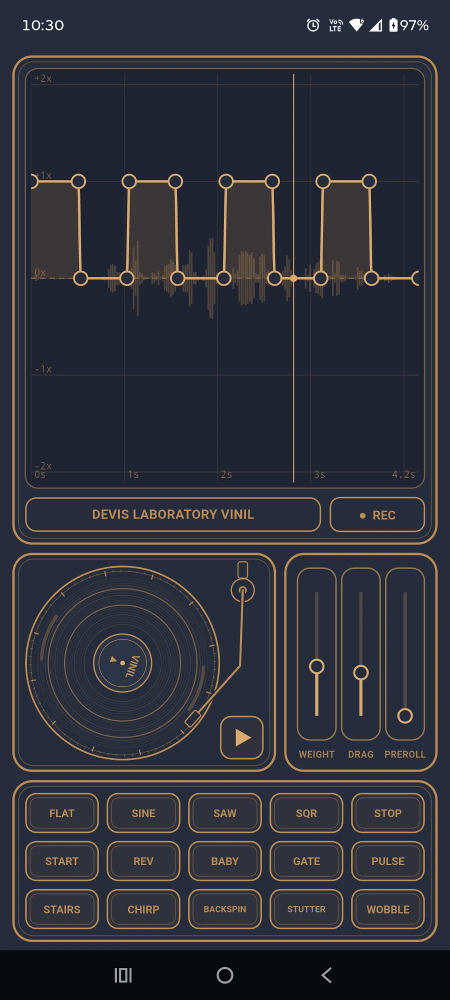

# Vinil

A pocket scratch app for iOS and Android, built with Flutter. Record a short sound with the microphone, then play it on a virtual turntable: grab the record and scratch it, or draw a playback-speed curve over the recording.

It is the phone version of the Devis Laboratory Vinil VST plugin, with the same scratch engine.



## What it does

- **Record** – the REC button records from the microphone, up to 20 seconds. The waveform is drawn live into the window while you record. When you stop, a shorter recording is stretched over the whole window. A new recording replaces the previous one, and the last recording is kept between launches.
- **Speed curve** – the top window shows the waveform with a curve on top of it. The X axis is time inside the recording, the Y axis is playback speed from −2× (reverse) through 0 (stop) to +2×. The recording loops, and the curve starts over with every loop.
- **Turntable** – put a finger on the record and move it around the centre, like a real DJ. Let go and the platter returns to normal speed and plays on from where it is. The play / stop button next to the record starts and stops the platter. The app always starts stopped and starts playing right after a recording.
- **Pads** – 15 ready-made curve shapes: FLAT, SINE, SAW, SQR, STOP, START, REV, BABY, GATE, PULSE, STAIRS, CHIRP, BACKSPIN, STUTTER, WOBBLE.

## Controls

| Control | What it does |
|---|---|
| **REC** | Start / stop recording (max 20 s) |
| **Curve** | Tap empty space to add a point, drag a point to move it, press and hold a point to delete it |
| **Record** | Touch and turn it to scratch |
| **Play / stop** | Start or stop the platter |
| **WEIGHT** | How heavy the record feels under your finger (low = follows the finger instantly, high = lazy and smooth) |
| **DRAG** | Inertia of the platter when it follows the curve |
| **PREROLL** | How far behind live the head restarts each loop, so the curve can also speed up |
| **Pads** | Replace the curve with a ready-made shape |

Double-tap a slider to reset it. The slider values and the curve are saved between launches.

## How it works

The audio engine is a straight port of the VST plugin to Dart (`lib/dsp/engine.dart`):

- the recording plays as a looping input into a circular buffer, and the read head moves with a variable step (the curve value or the finger), so the audio can slow down, stop and run backwards;
- 4-point Hermite interpolation for the fractional read position, and a short cross-fade whenever the head jumps (loop restart), so there are no clicks;
- a record held still reads one sample, which is faded to silence instead of a DC step.

Playback goes through `flutter_pcm_sound`, recording through `record`. The engine runs on the UI isolate, so it is best used in a release build.

## Run

```bash
flutter pub get
flutter run --release
```

A debug build is noticeably slower on a phone and can crackle. The microphone permission is asked for the first time you press REC.

## Tests

The offline DSP tests check for clicks, NaN, direction, the curve shapes, the start / stop of the platter and the stored recording:

```bash
flutter test
```

The app icon and the splash image are rendered by `tool/make_icon.dart`:

```bash
flutter test tool/make_icon.dart
dart run flutter_launcher_icons
dart run flutter_native_splash:create
```
